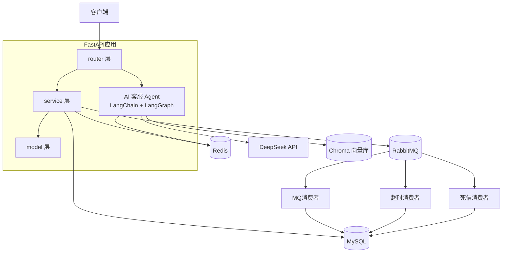

# order_center 订单系统


> 一句话介绍: 基于 FastAPI 的电商订单系统，含库存防超卖、MQ 异步解耦、超时关单、AI 客服 Agent (工具调用 + RAG + 记忆 + 降级)


## 技术栈
FastAPI + MySQL + Redis + RabbitMQ + httpx(DeepSeek API) + LangChain / LangGraph (Agent 编排) + Chroma (向量库) + bge-small-zh-v1.5 (embedding)


## 技术选型

- **Agent vs 固定 Workflow**: 用户问题类型不固定 (订单/库存/FAQ/物流)，固定路径覆盖不全，选 Agent 让模型自主决定调哪个工具。
- **LangChain**: 生态成熟，`create_agent` 直接跑 ReAct 循环 (底层 LangGraph)，工具封装现成，不用自己写循环。
- **Chroma + bge-small-zh-v1.5**: 本地零配置、中文优化、512维轻量、不用 API key，适合本地 RAG 验证。
- **Redis 存记忆**: 项目已有 Redis，TTL 可控 (24h)，跨请求持久化，服务重启记忆不丢 (vs InMemorySaver)


## 亮点 (3-5条)
 - Redis 分布式锁（product_id 粒度，Lua 原子释放，TTL 自动过期防死锁）解决并发超卖
 - RabbitMQ 异步扣库存 + 三层幂等（Redis setnx + DB 唯一约束 + 状态判断）+ 死信兜底 + 延迟队列
 - 基于 RabbitMQ TTL + DLX 模拟延迟队列实现 15min 超时关单，避免引入延迟队列插件
 - AI 客服 Agent（Tool-Calling + RAG + 记忆 + 两级降级，15s 超时兜底，零硬异常挂掉）


## 架构图



## 核心流程
详细时序图见 [docs/flow.md](docs/flow.md)，包含：

- 创建订单流程（加锁 → 锁库存 → 写订单 → 发 MQ → 消费者扣库存）
- 消费者重试与死信流程（临时故障重试 3 次 → 超限进死信队列）


## 功能模块
 - 用户 / 商品 / 订单 / 库存 / AI 咨询


## 如何跑起来

### 环境要求
- Python 3.11 ~ 3.13（测试于 3.13）
- MySQL 8.x
- Redis 6.x
- RabbitMQ 3.x

### 依赖安装
```bash
python -m venv .venv
# Windows
.venv\Scripts\activate
# macOS/Linux
source .venv/bin/activate

pip install -r requirements.txt
```

### .env 配置
```bash
cp .env.example .env
# 编辑 .env 填入你的 MySQL / Redis / RabbitMQ / DeepSeek Key
```

```dotenv
DB_HOST=localhost
DB_PORT=3306
DB_USER=root
DB_PASSWORD=your_mysql_password
DB_NAME=order_center
DB_POOL_SIZE=10
DB_MAX_OVERFLOW=20
DB_POOL_RECYCLE=3600
DB_ECHO=false

REDIS_HOST=127.0.0.1
REDIS_PORT=6379
REDIS_PASSWORD=
REDIS_LOCK_TTL=60

RABBITMQ_HOST=localhost
RABBITMQ_PORT=5672
RABBITMQ_LOGIN=guest
RABBITMQ_PASSWORD=guest
RABBITMQ_VHOST=/
MQ_RETRY_TTL_MS=5000
MQ_ORDER_TIMEOUT_MS=900000
MQ_RETRY_MAX=3

LLM_BASE_URL=https://api.deepseek.com
LLM_API_KEY=your_deepseek_key
LLM_MODEL=deepseek-flash
LLM_TIMEOUT_READ=30

JWT_SECRET_KEY=your-256-bit-secret-key-here
JWT_ALGORITHM=HS256
JWT_EXPIRE_MINUTES=60

LOG_LEVEL=INFO
API_PORT=8000
IDEMPOTENT_TTL_SECONDS=7200
ALERT_LOG_PATH=logs/dlx_alerts.log
```

### 数据库初始化
```bash
mysql -u root -p < docs/schema.sql
```

### 启动命令
```bash
# 0. (首次运行) 建 FAQ 向量索引 —— AI 客服 search_faq 工具依赖此产物
#    产物: data/chroma/ (已 .gitignore，不进仓库；docs/faq.txt 变更后需重新跑)
python scripts/build_faq_index.py

# 1. FastAPI 服务 (主程序)
uvicorn app.main:app --reload --port 8000

# 2. MQ 消费者 (订单创建后异步扣库存)
python scripts/consumer.py

# 3. 超时关单消费者 (15min 未支付自动关单)
python scripts/consumer_timeout.py

# 4. 死信队列消费者 (异常消息落地记录)
python scripts/consumer_dlx.py
```

### 服务依赖
启动顺序：MySQL → Redis → RabbitMQ → FastAPI → 各消费者

### 交互文档启动后可访问
- **Swagger UI**（交互式测试）: http://localhost:8000/docs
- **ReDoc**（只读文档）: http://localhost:8000/redoc

### E2E 自动化测试

基于 **pytest + httpx** 的端到端测试，覆盖完整用户旅程和 4 个异常场景，全绿 ✅。

```bash
# 前置: FastAPI + MQ 消费者都要启动
python -m pytest tests/ -v -s
```

详细用例见 [tests/test_flow_e2e.py](tests/test_flow_e2e.py)

### 快速体验（curl 链路）

以下是一个从"注册用户 → 浏览商品 → 创建订单 → 模拟支付 → AI咨询"的完整链路，复制即可跑。

> **注意**：Windows 用户请用 Git Bash / WSL，或把 `curl` 换成 `curl.exe`。

```bash
BASE=http://localhost:8000

# 1. 用户注册 (返回 user_id)
curl -s -X POST $BASE/api/user/register \
  -H "Content-Type: application/json" \
  -d '{"user_name":"testuser","user_password":"123456"}'

# 2. 登录 (返回 data.token + data.user，后续要用 TOKEN)
curl -s -X POST $BASE/api/user/login \
  -H "Content-Type: application/json" \
  -d '{"user_name":"testuser","user_password":"123456"}'
# 把返回的 data.token 复制出来，或手动设变量:
# TOKEN=eyJhbGciOiJIUzI1NiIsInR5cCI6IkpXVCJ9...

# 3. 查看商品列表 (公开接口，无需 token)
curl -s $BASE/api/product/list

# 3.5 查某个商品的实际库存 (available_stock)
curl -s $BASE/api/product/2

# 4. 创建订单 (需 token；body 只传 items，user_id 从 token 取)
curl -s -X POST $BASE/api/order/create \
  -H "Content-Type: application/json" \
  -H "Authorization: Bearer $TOKEN" \
  -d '{"items":[{"product_id": 2, "order_item_num": 1}]}'

# 5. 模拟支付 (需 token；替换 ORDER_ID 为 Step4 返回值)
curl -s -X POST $BASE/api/order/pay/ORDER_ID \
  -H "Authorization: Bearer $TOKEN"

# 6. AI 咨询: 问订单物流 (Agent 会调 get_logistics + get_order_info)
curl -s "$BASE/api/order/consult/ORDER_ID?question=我的订单什么时候能送到?" \
  -H "Authorization: Bearer $TOKEN"

# 7. AI 咨询: 问平台规则 (Agent 会调 search_faq 检索 FAQ)
curl -s "$BASE/api/order/consult/ORDER_ID?question=怎么取消订单?" \
  -H "Authorization: Bearer $TOKEN"

# 说明: 第6、7条走Agent: 模型自主决定调 get_logistics / get_order_info / search_faq。 Agent 硬异常、超时(15s)、返回空或过短时，自动退回旧 ai_service 兜底。
```

> 如果商品表为空，先通过以下命令创建商品和库存：
> ```bash
> curl -s -X POST $BASE/api/product/create \
>   -H "Content-Type: application/json" \
>   -d '{"product_name":"测试商品","product_type":"数码","product_amount":99.9,"total_stock":100}'
> ```

## 接口文档
见 docs/api.md


## AI 客服 Agent 章节

### 从固定 Prompt 到 Tool-Calling Agent
原实现: 查订单拼 prompt，调一次 DeepSeek，固定路径。
现实现: LangChain `create_agent` (底层 LangGraph 循环)，模型自主决定调哪个工具、调几次。


### 架构
用户问题 + 历史记忆 (Redis)
  → LLM 决定调哪个工具
  → 执行工具 (查订单/库存/FAQ/...)
  → 结果塞回 LLM
  → 决定是否继续调
  → 最终回答


### 工具 (6个)
| 工具 | 作用 | 
| --- | --- |
| get_order_info | 按订单 ID 查状态、金额、创建时间 |
| get_inventory | 按商品 ID 查可用库存 |
| get_logistics | 查物流(项目无物流表，返回固定文案不瞎编) |
| get_orders_item | 查当前用户最近订单列表 |
| get_product_detail | 按商品 ID 查价格、类型 |
| search_faq | 从 Chroma 知识库检索 FAQ (RAG) | 


### 能力
- **RAG**: FAQ 存 Chroma (bge-small-zh-v1.5 embedding)，`search_faq` 检索相关条目，模型组织回答
- **记忆**: Redis 存对话历史，`thread_id = user_id_order_id` 隔离，TTL 24小时。Agent 记忆独立用 Redis Stack (默认 6380)，与业务 Redis (6379) 隔离
- **降级（两级兜底）**:
  - 第一级（路由层）: Agent 硬异常 / `asyncio.wait_for` 超时 15s / `len(answer.strip()) < 3` → 退回旧 `ai_service`（固定 prompt 单轮调 LLM）
  - 第二级（ai_service 内部）: LLM 调用失败（`LLMCallError`）→ 按订单状态返回预定义兜底文案，完全不调 LLM 也能答
- **异常处理**: ToolErrorMiddleware 转述工具异常，Agent 不崩；recursion_limit=7 防死循环


### 关键文件
- `app/agent/agent.py`: create_agent 组装、RedisSaver、ToolErrorMiddleware
- `app/agent/tools.py`: 6个工具
- `app/agent/state.py`: ConsultState (user_id 注入)
- `scripts/build_faq_index.py`: FAQ 建索引
- `docs/faq.txt`: 17条 FAQ 


## 亮点 / 难点

### 1. 并发超卖 → 分布式锁
压测模拟 200 并发下单，出现超卖。用 Redis 分布式锁（product_id 粒度，升序加锁防死锁，Lua 释放）解决。详见 [anomaly_report.md](docs/anomaly_report.md)。

### 2. 消息重复消费 → 三层幂等
模拟重复消费导致重复扣库存。用三层幂等解决：Redis setnx（快）+ DB 唯一约束（可靠）+ status 状态判断（兜底）。详见 [anomaly_report.md](docs/anomaly_report.md)。

### 3. 超时关单与消费者的竞态
消费者先扣库存、超时关单再回滚，导致库存乱。用"查 consumer_idempotent 判断消费者状态 + FOR UPDATE 行锁"解决。详见 [anomaly_report.md](docs/anomaly_report.md)。


## 工程化改造

在功能完成基础上，对项目做企业级规范改造，每项都有“改造前 vs 改造后”。

### 异常与返回体
- 13 类自定义异常统一归属 5 个全局 handler（business 9 类→400、forbidden→403、validation→400+全字段、token_invalid→401、unhandled→500），500 兜底统一返回体、记堆栈不记敏感
- 全接口统一 `{code, msg, data}`，/health 也统一

### 参数校验
- 校验失败返回全部错误 `data: [{field, msg}]`，字段路径全拼可定位嵌套

### 日志与配置
- 统一 logging：控制台 + `logs/app.log`、行号、毫秒；httpx 噪音降级
- 环境相关配置全进 Settings（.env 可配），代码零硬编码

### 接口文档
- 12 接口补 description、参数描述、错误响应声明，新增 `ErrorResponse` 通用模型

### 安全
- JWT 鉴权（签发/校验），7 个接口鉴权 + 归属校验（403）
- 身份从 token 取，不信任前端传参；`create_order` 消除 body 传 user_id 越权

### 其他
- 死信告警文件异步写（aiofiles），不阻塞事件循环


## 已知缺陷与未来优化方向

> 以下是项目当前已知的局限，按主题归类。完整台账与逐条分析见 [docs/known_issues.md](docs/known_issues.md)。

### 并发与一致性

- **分布式锁为单点模式**：`SET NX PX` 单 Redis 实例加锁，宕机时锁失效，可升级 Redlock 或多节点锁（etcd）。
- **扣库存/回滚不幂等**：`UPDATE total = total - n` 重复执行会重复扣，消息重投或超时回滚时数据不一致，根治需扣减可重入（记录扣减流水）。
- **支付无并发控制**：`pay_order` 裸查改，真实支付场景双并发会重复触发，需 `FOR UPDATE` 行锁或乐观锁 version。
- **锁冲突不重试**：抢不到锁即返回 400，高并发下成功数低于库存数，可加自旋/等待重试。

### 消息可靠性

- **超时消息发布失败丢计时**：订单 commit 后才发 `order.timeout`，publish 失败则订单永不关单，需本地消息表或事务消息保证原子。
- **重试无上限阈值 / 死信归档缺失**：临时故障重试 3 次后进死信，次数硬编码，死信只落表无归档策略，可做阈值可配 + 定期归档。
- **死信查不到记录直接 ACK**：查 `dlx_msg` 失败时告警后 ACK，消息会彻底丢失，应改为不 ACK 转兜底队列。
- **一条 order_id 多条死信只标一条**：`LIMIT 1` 只标记最新一条，多条未处理死信会漏标，应按 `msg_id` 精确标记。
- **超时关单与消费者存在理论竞态**：Day13 已加 `consumer_idempotent` 判断 + `FOR UPDATE` 行锁解决主要冲突，但判断到回滚之间仍有窗口，根治需锁订单行做大事务。

### 架构

- **同步 DB + 异步外壳矛盾**：FastAPI async 接口内用同步 SQLAlchemy，阻塞事件循环，200 并发打崩连接池，彻底解决需换 asyncpg 或同步操作丢线程池，调大连接池仅治标。

### 安全与健壮性

- ~~consult 不校验订单归属~~：已在工程化改造（JWT 鉴权）中解决，pay/consult 现校验 token 归属返回 403。
- ~~全局校验 handler 只返回第一条错误~~：已在工程化改造（参数校验）中解决，现返回全部错误字段路径。

### 可观测性

- ~~死信消费者同步写文件阻塞~~：已在工程化改造中解决，现用 aiofiles 异步写不阻塞事件循环。
- ~~httpx INFO 日志噪音~~：已在工程化改造（日志系统）中解决，httpx logger 调到 WARNING。

### AI 模块 (Agent)

- ~~大模型调用为同步单次响应、无上下文记忆~~: 阶段5 已升级为 Tool-Calling Agent，Redis 存对话历史 (thread_id = user_id_order_id, TTL 24h)，支持多轮上下文。
- **单 Agent 串行调用**: 模型一次调一个工具，多工具场景串行等待，可优化为并行工具调用。
- **记忆 TTL 24h 到期即丢**: 设计如此(客服场景当天追问为主)，非 bug；如需长期记忆需引入 Store 层。
- **无正式评估指标**: 目前只有 8 个问题的轻评估(人眼看工具调用和回答)，无 faithfulness / answer relevance 等量化指标。
- **无多 Agent 协作**: 单 Agent 编排，未做 Supervisor / 订单 Agent / 售后 Agent 分工。
- **无 Human-in-the-loop**: 高风险操作 (如退款) 未接人工审批。
- **无可观测性**: 未接 LangSmith tracing，Agent 每步决策不可视。


## 项目结构

```
order_center/
├── app/                     # FastAPI 应用
│   ├── models/              # SQLAlchemy ORM 模型
│   │   ├── user.py          # 用户表
│   │   ├── product.py       # 商品表
│   │   ├── inventory.py     # 库存表 (total_stock / locked_stock)
│   │   └── order.py         # 订单 + 订单项
│   ├── routers/             # API 路由层
│   │   ├── user.py          # 注册 / 登录 (JWT 出参) / info (Bearer 鉴权)
│   │   ├── product.py       # 商品列表 / 详情 / 新增 (公开)
│   │   ├── order.py         # create / list / detail / cancel / pay (全路由 JWT 鉴权 + 归属校验)
│   │   └── ai.py            # consult (JWT 鉴权 + 归属校验 / Agent + 旧 ai_service 降级)
│   ├── schemas/             # Pydantic 请求/响应模型
│   │   ├── common.py        # Response{T} 统一返回体 + ErrorResponse 通用错误
│   │   ├── user.py
│   │   ├── product.py
│   │   ├── order.py
│   │   └── ai.py
│   ├── services/            # 业务逻辑层
│   │   ├── order_service.py # 订单核心逻辑 + MQ 消费逻辑 (扣库存 / 超时关单)
│   │   ├── user_service.py
│   │   ├── product_service.py
│   │   └── ai_service.py    # 旧 consult (Agent 降级时兜底)
│   ├── utils/               # 工具类
│   │   ├── exceptions.py    # 13 类自定义业务异常 (9 business → 400 / forbidden → 403 / token_invalid → 401)
│   │   ├── deps.py          # FastAPI 依赖注入: HTTPBearer + get_current_user
│   │   ├── lock.py          # Redis 分布式锁 (product_id 粒度, Lua 释放)
│   │   ├── logger.py        # 统一日志 (控制台 + app.log, 行号, 毫秒, httpx→WARNING)
│   │   ├── security.py      # 密码 Argon2id 哈希 + jose JWT 签发/校验
│   │   └── llm_client.py    # httpx 封装 DeepSeek API
│   ├── agent/               # AI 客服 Agent (LangChain + LangGraph)
│   │   ├── agent.py         # create_agent 组装、RedisSaver、ToolErrorMiddleware
│   │   ├── tools.py         # 6个工具 (@tool 装饰)
│   │   └── state.py         # ConsultState (user_id 注入)
│   ├── config.py            # 读取 .env
│   ├── database.py          # SQLAlchemy engine + SessionLocal
│   ├── mq_client.py         # RabbitMQ 连接 / 队列 / 交换机初始化
│   ├── redis_client.py
│   └── main.py              # FastAPI 入口 (注册路由 / 异常 handler)
├── scripts/                 # 独立运行的消费者
│   ├── consumer.py          # order.create.queue → 异步扣库存 + 幂等 + 死信
│   ├── consumer_timeout.py  # 15min 延迟队列 → 超时关单 + 回滚库存
│   ├── consumer_dlx.py      # 死信队列 → 写 dlx_msg 表
│   ├── load_test.py         # 压测脚本
│   ├── mq_dup_test.py       # MQ 幂等重复投递测试
│   ├── build_faq_index.py   # FAQ 建 Chroma 索引 (离线跑一次)
│   └── test_day11_faq.py    # search_faq 检索验证
├── tests/                   # E2E 自动化测试 (pytest + httpx)
│   └── test_flow_e2e.py     # 5 个用例: 完整链路 + 4 个异常场景
├── docs/
│   ├── schema.sql           # 建表 SQL
│   ├── api.md               # 接口文档
│   ├── flow.md              # 时序图 (mermaid)
│   ├── known_issues.md      # 已知问题台账
│   ├── anomaly_report.md    # Day6-Day9 异常报告 (历史冻结)
│   ├── project_requirements.md
│   ├── risks.md
│   ├── faq.txt               # 17 条客服 FAQ (RAG 知识库)
│   └── stage5_day13_interview_talk.md   # 阶段5 面试话术
├── .env.example
├── requirements.txt
└── README.md
```