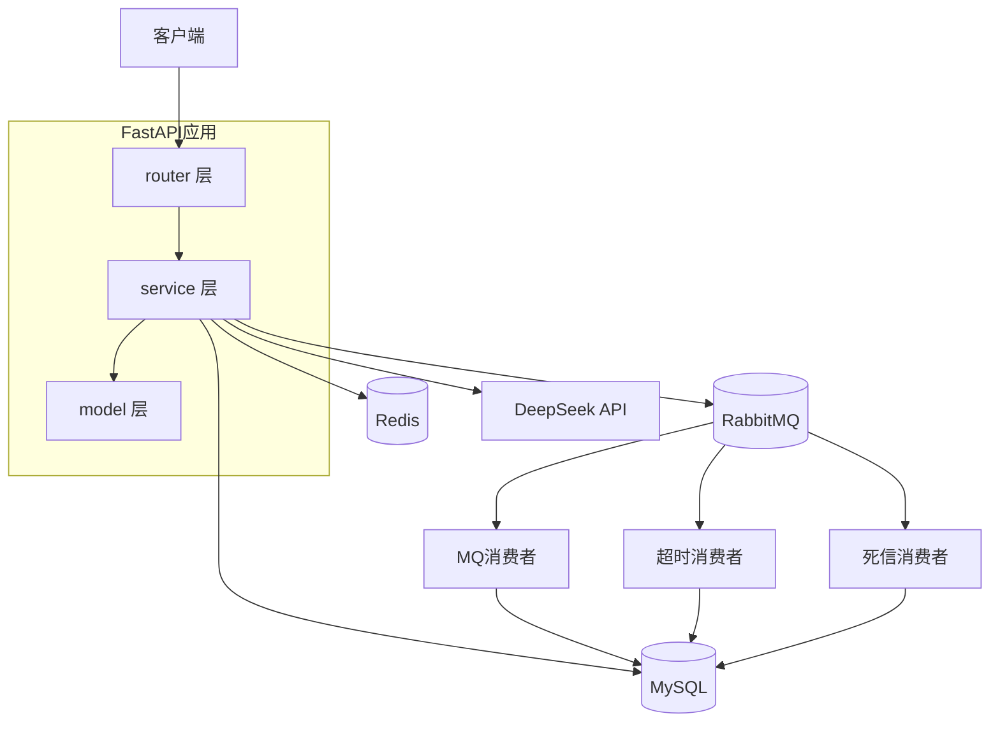

# order_center 订单系统


> 一句话介绍: 基于 FastAPI 的电商订单系统，含库存防超卖、MQ 异步解耦、超时关单、AI 订单咨询


## 技术栈
FastAPI + MySQL + Redis + RabbitMQ + httpx(DeepSeek API)


## 亮点 (3-5条)
 - Redis 分布式锁（product_id 粒度，Lua 原子释放，TTL 自动过期防死锁）解决并发超卖
 - RabbitMQ 异步扣库存 + 三层幂等（Redis setnx + DB 唯一约束 + 状态判断）+ 死信兜底 + 延迟队列
 - 基于 RabbitMQ TTL + DLX 模拟延迟队列实现 15min 超时关单，避免引入延迟队列插件
 - AI 订单咨询（调 DeepSeek 大模型，httpx 异步调用，失败降级返回兜底话术）


## 架构图



## 核心流程
详细时序图见 [docs/flow.md](docs/flow.md)，包含：

- 创建订单流程（加锁 → 锁库存 → 写订单 → 发 MQ → 消费者扣库存）
- 消费者重试与死信流程（临时故障重试 3 次 → 超限进死信队列）


## 功能模块
 - 用户 / 商品 / 订单 / 库存 / AI 咨询


## 如何跑起来

### 环境要求
- Python 3.11 ~ 3.13（测试于 3.13）
- MySQL 8.x
- Redis 6.x
- RabbitMQ 3.x

### 依赖安装
```bash
python -m venv .venv
# Windows
.venv\Scripts\activate
# macOS/Linux
source .venv/bin/activate

pip install -r requirements.txt
```

### .env 配置
```bash
cp .env.example .env
# 编辑 .env 填入你的 MySQL / Redis / RabbitMQ / DeepSeek Key
```

```dotenv
DB_HOST=localhost
DB_PORT=3306
DB_USER=root
DB_PASSWORD=your_mysql_password
DB_NAME=order_center

REDIS_HOST=127.0.0.1
REDIS_PORT=6379
REDIS_PASSWORD=

RABBITMQ_HOST=localhost
RABBITMQ_PORT=5672
RABBITMQ_LOGIN=guest
RABBITMQ_PASSWORD=guest
RABBITMQ_VHOST=/

LLM_BASE_URL=https://api.deepseek.com
LLM_API_KEY=your_deepseek_key
LLM_MODEL=deepseek-flash
```

### 数据库初始化
```bash
mysql -u root -p < docs/schema.sql
```

### 启动命令
```bash
# 1. FastAPI 服务 (主程序)
uvicorn app.main:app --reload --port 8000

# 2. MQ 消费者 (订单创建后异步扣库存)
python scripts/consumer.py

# 3. 超时关单消费者 (15min 未支付自动关单)
python scripts/consumer_timeout.py

# 4. 死信队列消费者 (异常消息落地记录)
python scripts/consumer_dlx.py
```

### 服务依赖
启动顺序：MySQL → Redis → RabbitMQ → FastAPI → 各消费者

### 交互文档启动后可访问
- **Swagger UI**（交互式测试）: http://localhost:8000/docs
- **ReDoc**（只读文档）: http://localhost:8000/redoc

### E2E 自动化测试

基于 **pytest + httpx** 的端到端测试，覆盖完整用户旅程和 4 个异常场景，全绿 ✅。

```bash
# 前置: FastAPI + MQ 消费者都要启动
python -m pytest tests/ -v -s
```

详细用例见 [tests/test_flow_e2e.py](tests/test_flow_e2e.py)

### 快速体验（curl 链路）

以下是一个从"注册用户 → 浏览商品 → 创建订单 → 模拟支付 → AI咨询"的完整链路，复制即可跑。

> **注意**：Windows 用户请用 Git Bash / WSL，或把 `curl` 换成 `curl.exe`。

```bash
BASE=http://localhost:8000

# 1. 用户注册 (返回 user_id)
curl -s -X POST $BASE/api/user/register \
  -H "Content-Type: application/json" \
  -d '{"user_name":"testuser","user_password":"123456"}'

# 2. 登录 (返回 user_id)
curl -s -X POST $BASE/api/user/login \
  -H "Content-Type: application/json" \
  -d '{"user_name":"testuser","user_password":"123456"}'

# 3. 查看商品列表
curl -s $BASE/api/product/list

# 3.5 查某个商品的实际库存 (available_stock)
curl -s $BASE/api/product/2        # product_id=2 当前有库存，可直接用

# 4. 创建订单 (替换 USER_ID 为 Step1 返回的值；商品建议用 product_id=2)
curl -s -X POST $BASE/api/order/create \
  -H "Content-Type: application/json" \
  -d '{"user_id": USER_ID, "items":[{"product_id": 2, "order_item_num": 1}]}'

# 5. 模拟支付 (把 ORDER_ID 替换成上一步返回的值)
curl -s -X POST $BASE/api/order/pay/ORDER_ID

# 6. AI 咨询订单状态
curl -s -X POST $BASE/api/order/consult/ORDER_ID \
  -H "Content-Type: application/json" \
  -d '{"question":"我的订单什么时候能送到？"}'
```

> 如果商品表为空，先通过以下命令创建商品和库存：
> ```bash
> curl -s -X POST $BASE/api/product/create \
>   -H "Content-Type: application/json" \
>   -d '{"product_name":"测试商品","product_type":"数码","product_amount":99.9,"total_stock":100}'
> ```

## 接口文档
见 docs/api.md


## 亮点 / 难点

### 1. 并发超卖 → 分布式锁
压测模拟 200 并发下单，出现超卖。用 Redis 分布式锁（product_id 粒度，升序加锁防死锁，Lua 释放）解决。详见 [anomaly_report.md](docs/anomaly_report.md)。

### 2. 消息重复消费 → 三层幂等
模拟重复消费导致重复扣库存。用三层幂等解决：Redis setnx（快）+ DB 唯一约束（可靠）+ status 状态判断（兜底）。详见 [anomaly_report.md](docs/anomaly_report.md)。

### 3. 超时关单与消费者的竞态
消费者先扣库存、超时关单再回滚，导致库存乱。用"查 consumer_idempotent 判断消费者状态 + FOR UPDATE 行锁"解决。详见 [anomaly_report.md](docs/anomaly_report.md)。

## 已知缺陷与未来优化方向

> 以下是项目当前已知的局限，按主题归类。完整台账与逐条分析见 [docs/known_issues.md](docs/known_issues.md)。

### 并发与一致性

- **分布式锁为单点模式**：`SET NX PX` 单 Redis 实例加锁，宕机时锁失效，可升级 Redlock 或多节点锁（etcd）。
- **扣库存/回滚不幂等**：`UPDATE total = total - n` 重复执行会重复扣，消息重投或超时回滚时数据不一致，根治需扣减可重入（记录扣减流水）。
- **支付无并发控制**：`pay_order` 裸查改，真实支付场景双并发会重复触发，需 `FOR UPDATE` 行锁或乐观锁 version。
- **锁冲突不重试**：抢不到锁即返回 400，高并发下成功数低于库存数，可加自旋/等待重试。

### 消息可靠性

- **超时消息发布失败丢计时**：订单 commit 后才发 `order.timeout`，publish 失败则订单永不关单，需本地消息表或事务消息保证原子。
- **重试无上限阈值 / 死信归档缺失**：临时故障重试 3 次后进死信，次数硬编码，死信只落表无归档策略，可做阈值可配 + 定期归档。
- **死信查不到记录直接 ACK**：查 `dlx_msg` 失败时告警后 ACK，消息会彻底丢失，应改为不 ACK 转兜底队列。
- **一条 order_id 多条死信只标一条**：`LIMIT 1` 只标记最新一条，多条未处理死信会漏标，应按 `msg_id` 精确标记。
- **超时关单与消费者存在理论竞态**：Day13 已加 `consumer_idempotent` 判断 + `FOR UPDATE` 行锁解决主要冲突，但判断到回滚之间仍有窗口，根治需锁订单行做大事务。

### 架构

- **同步 DB + 异步外壳矛盾**：FastAPI async 接口内用同步 SQLAlchemy，阻塞事件循环，200 并发打崩连接池，彻底解决需换 asyncpg 或同步操作丢线程池，调大连接池仅治标。

### 安全与健壮性

- **consult 不校验订单归属**：`/api/order/consult/{order_id}` 不校验 user_id，存在越权查询风险，应校验订单归属。
- **全局校验 handler 只返回第一条错误**：多字段校验失败时用户一次只见一个错，可聚合全部错误字段返回。

### 可观测性

- **死信消费者同步写文件阻塞**：同步 `open(..., "a")` 在死信爆发时阻塞事件循环，可改异步写（aiofiles）或队列化。
- **httpx INFO 日志噪音**：全局 INFO 级别下 httpx 每条请求都打日志，可将第三方库 logger 调到 WARNING。

### AI 模块

- **大模型调用为同步单次响应**：httpx 单次请求等完整回复，长回答等待久、无上下文记忆，可优化流式输出（SSE）与会话历史。

## 项目结构

```
order_center/
├── app/                     # FastAPI 应用
│   ├── models/              # SQLAlchemy ORM 模型
│   │   ├── user.py          # 用户表
│   │   ├── product.py       # 商品表
│   │   ├── inventory.py     # 库存表 (total_stock / locked_stock)
│   │   └── order.py         # 订单 + 订单项
│   ├── routers/             # API 路由层
│   │   ├── user.py          # 注册 / 登录 / 查用户 (Argon2id)
│   │   ├── product.py       # 商品列表 / 详情 / 新增
│   │   ├── order.py         # 创建订单 / 列表 / 详情 / 取消 / 模拟支付
│   │   └── ai.py            # AI 订单咨询 (DeepSeek + 降级兜底)
│   ├── schemas/             # Pydantic 请求/响应模型
│   ├── services/            # 业务逻辑层
│   │   ├── order_service.py # 订单核心逻辑 + MQ 消费逻辑 (扣库存 / 超时关单)
│   │   ├── user_service.py
│   │   ├── product_service.py
│   │   └── ai_service.py
│   ├── utils/               # 工具类
│   │   ├── exceptions.py    # 自定义业务异常
│   │   ├── lock.py          # Redis 分布式锁 (product_id 粒度, 60s TTL)
│   │   ├── security.py      # 密码哈希与校验 (Argon2id)
│   │   └── llm_client.py    # httpx 封装 DeepSeek API
│   ├── config.py            # 读取 .env
│   ├── database.py          # SQLAlchemy engine + SessionLocal
│   ├── mq_client.py         # RabbitMQ 连接 / 队列 / 交换机初始化
│   ├── redis_client.py
│   └── main.py              # FastAPI 入口 (注册路由 / 异常 handler)
├── scripts/                 # 独立运行的消费者
│   ├── consumer.py          # order.create.queue → 异步扣库存 + 幂等 + 死信
│   ├── consumer_timeout.py  # 15min 延迟队列 → 超时关单 + 回滚库存
│   ├── consumer_dlx.py      # 死信队列 → 写 dlx_msg 表
│   ├── load_test.py         # 压测脚本
│   └── mq_dup_test.py       # MQ 幂等重复投递测试
├── tests/                   # E2E 自动化测试 (pytest + httpx)
│   └── test_flow_e2e.py     # 5 个用例: 完整链路 + 4 个异常场景
├── docs/
│   ├── schema.sql           # 建表 SQL
│   ├── api.md               # 接口文档
│   ├── flow.md              # 时序图 (mermaid)
│   ├── known_issues.md      # 已知问题台账
│   ├── anomaly_report.md    # Day6-Day9 异常报告 (历史冻结)
│   ├── project_requirements.md
│   └── risks.md
├── .env.example
├── requirements.txt
└── README.md
```