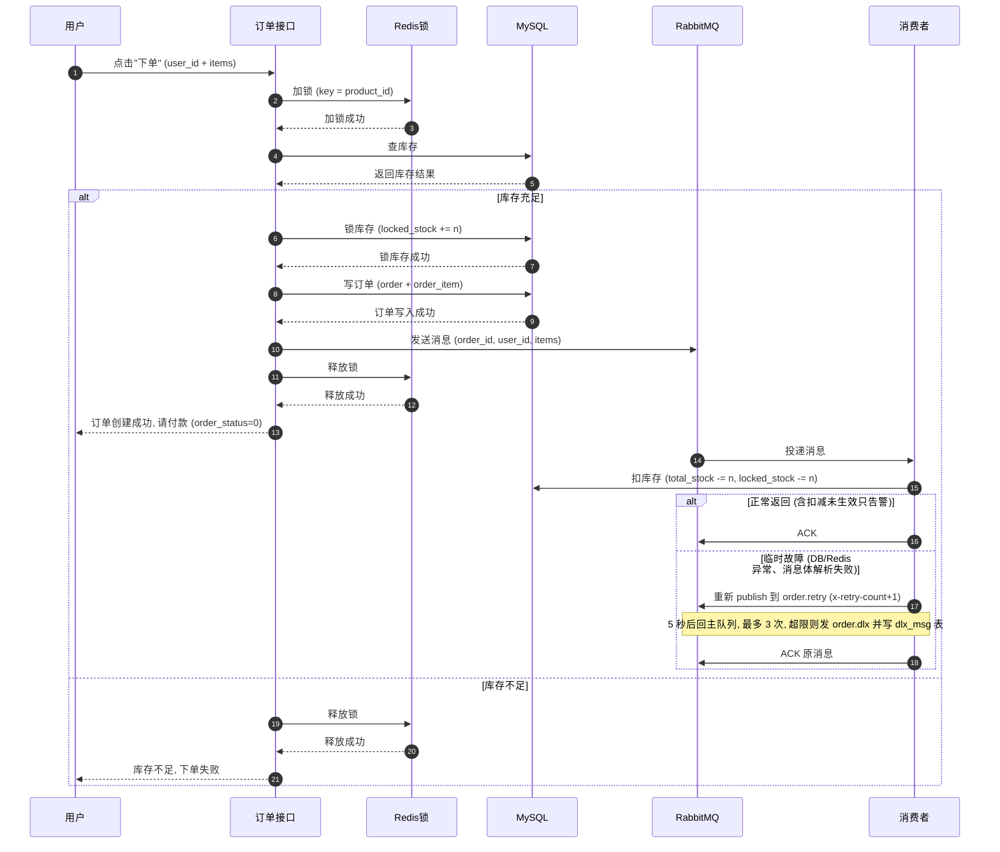
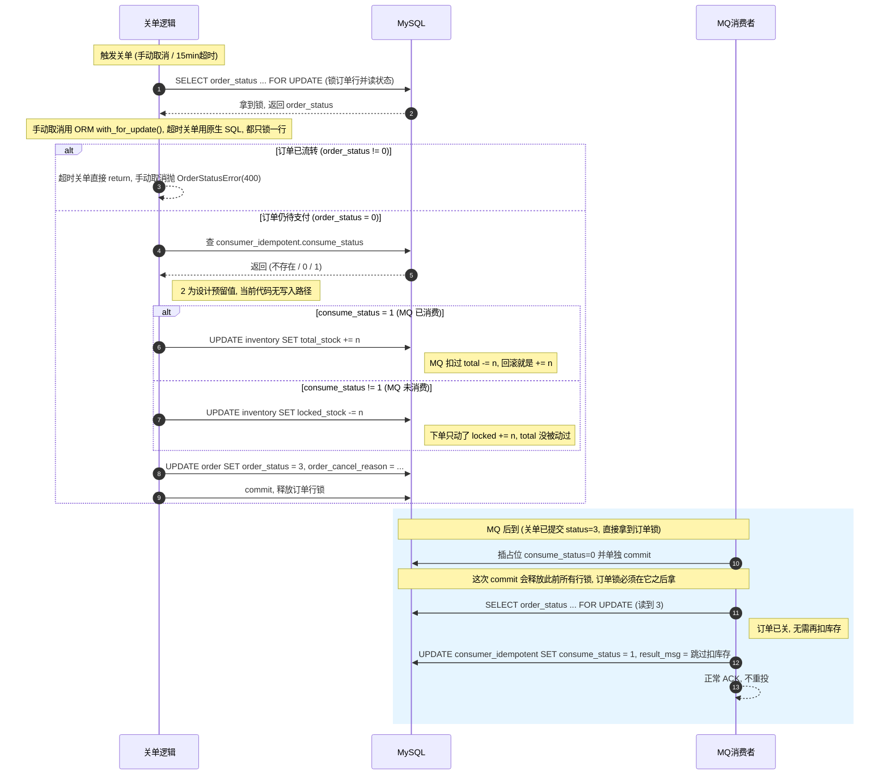
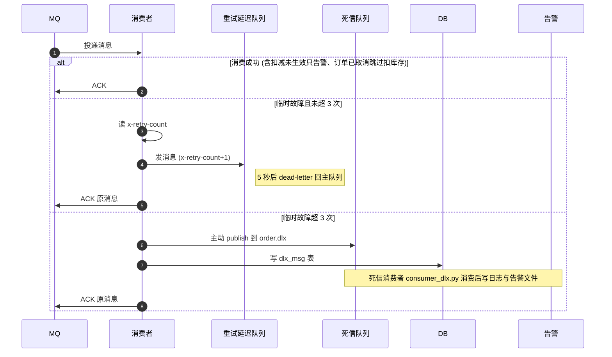

### 创建订单流程

### 关单与库存回滚流程（手动取消 / 超时自动取消）

关单和 MQ 消费者对同一订单**通过订单行锁（FOR UPDATE）串行化**，不可能同时跑。

**关单库存回滚规则**
- 先拿订单行锁 `FOR UPDATE`，锁覆盖「判断 → 改库存 → 改订单状态」全过程，与 MQ 消费者串行化
- 再按 `product_id` 升序拿 `inventory` 行锁，与下单/扣库存顺序一致，防死锁
- 查 `consumer_idempotent.consume_status` 判断 MQ 状态（订单级可靠信号，与扣库存在同一事务提交）；运行时只会出现 0 处理中 / 1 已处理(扣减成功或跳过扣库存)，记录不存在时也视为未消费。`2 失败` 是 `schema.sql` 注释保留的设计预留值，当前代码没有任何写入 2 的路径；`consume_order` 第三层是「`==1` 才 return」，读到任何非 1 值仍会继续处理
- `consume_status = 1`（MQ 已扣过）→ 只补回 `total_stock += n`
- `consume_status != 1`（含 0 / 不存在，以及历史残留的 2）→ 只释放 `locked_stock -= n`
- 两条分支由 `if consumer_done / else` 天然互斥；订单行锁的作用是让判断与回滚期间 MQ 插不进来，保证读到的 `consume_status` 是已提交的最终值
- 注：`consume_status=1` 也被「订单不存在 / 已取消，跳过扣库存」两个分支复用。这两类订单已不是待支付状态，不会再触发关单回滚，所以不影响上面的流程；但信号语义不纯，属明确保留的边界（见 README「已知缺陷」）

**为什么 MQ 未消费时不补 total_stock？**
下单只动了 `locked_stock += n`，`total_stock` 一分没动。MQ 未消费意味着 total 从来没被减过，关单补 total 就是凭空捏造的回滚。

### 消费者重试与死信流程

### 说明

**锁**
- 锁的 key：`product_id`（按商品粒度锁，不同商品互不影响）
- 锁的持有范围：加锁 → 查库存 → 锁库存 → 写订单 → 发MQ → 释放锁
- 锁的释放时机：发完 MQ 即释放，不等消费者

**MQ 消息内容**
- order_id：消费者定位订单
- user_id：日志追踪
- items：商品列表，每项含 product_id、order_item_num、order_item_amount

**消费者**
- 执行顺序：Redis `SET NX EX` 抢幂等 key → 查 `consume_status` 决定是否插占位 → 插占位 `consume_status=0` 并**单独 commit** → 拿订单行锁 `FOR UPDATE`（必须在这次 commit 之后，否则锁会被释放）
- 主要职责：扣减库存（`total_stock -= n, locked_stock -= n`），按 `product_id` 升序；UPDATE 影响 0 行只打 warning、不抛错
- 拿锁后查 `order_status`，已关单（=3）或订单不存在则跳过扣库存，置 `consume_status=1` + `result_msg` 并正常返回
- 扣库存与置 `consume_status=1` 在同一事务同一次 commit
- 不改订单状态、不写物流（这些属于付款流程）

**重试策略**
- 只对临时故障（DB/Redis 异常、消息体解析失败）重试：ACK 原消息 + 重新 publish 一条带 `x-retry-count` 的新消息到 `order.retry.queue`（TTL 5s，dead-letter 回 `order.create`），最多 3 次
- 超限 → 主动 publish 到 `order.dlx` 并写 `dlx_msg` 表
- 代码里没有 `basic_nack`；`ConsumeStockError` 的「业务失败直接进死信」分支已成死代码（全仓无 `raise`），`rowcount=0` 现在只打 warning、置 `consume_status=1` 并正常 ACK

**库存不足分支**
- 释放锁 → 返回用户"库存不足"，订单不创建